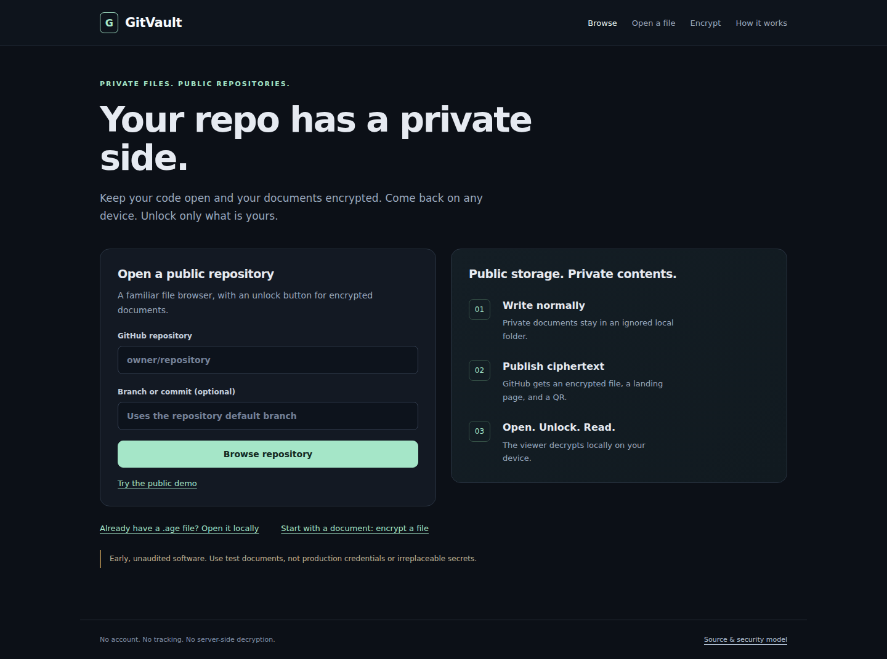
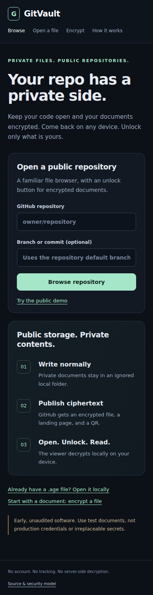
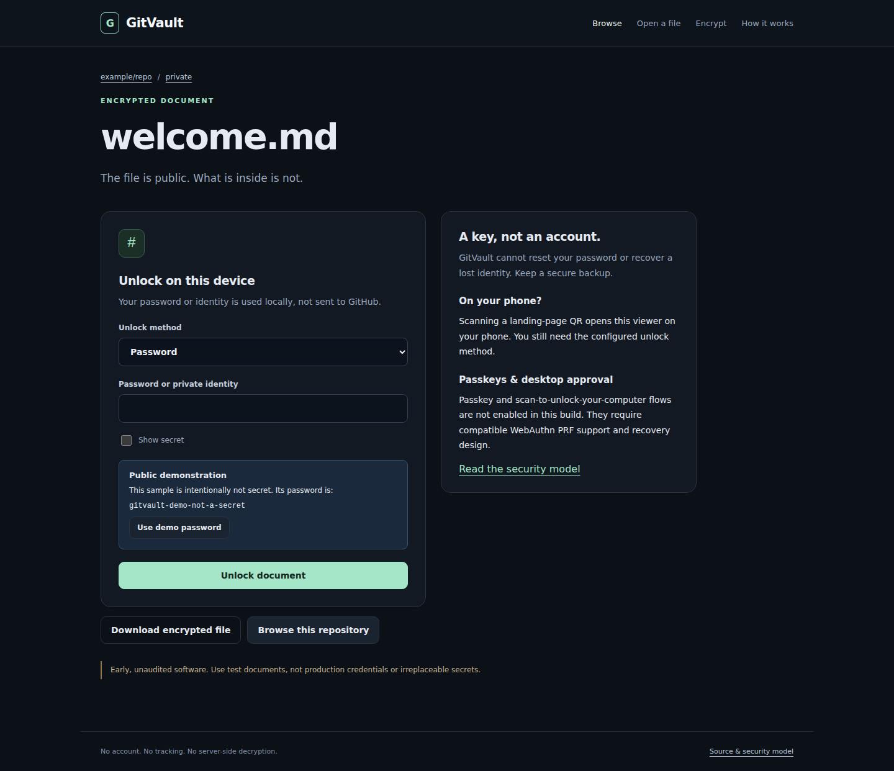
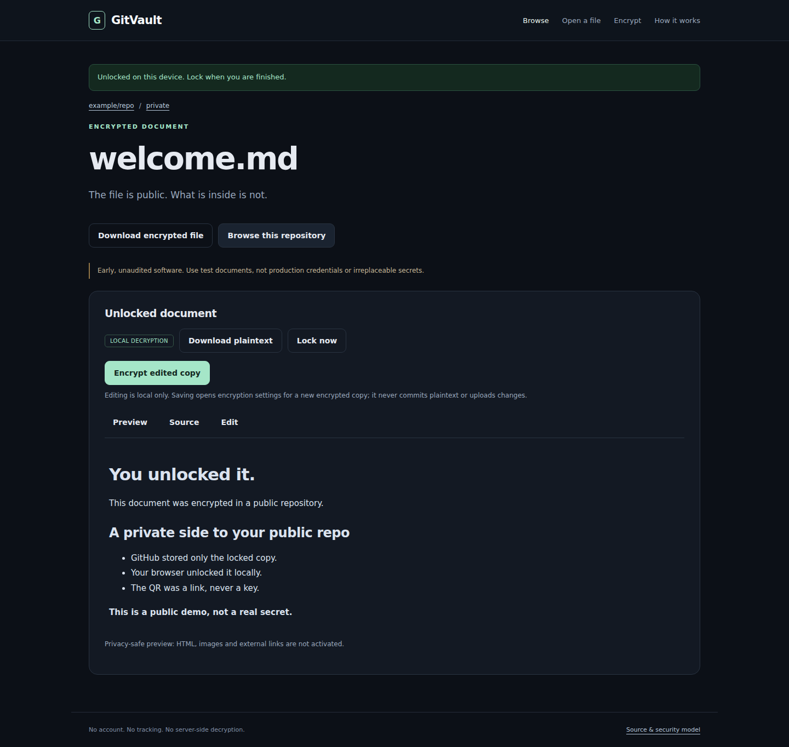

# GitVault: real browser screenshots

These images were captured from the running application, not design mockups. All visible documents and credentials are intentionally public test fixtures.

Tested source commit: `4d1f2e90b3a0cb57a46ef325e948131e3f956ceb`.

[Successful browser verification](https://github.com/junovhs/gitvault/actions/runs/37996037573)

The current application can be newer than this screenshot set. Screenshots do not imply physical-phone or passkey-provider compatibility testing.

## Desktop home

## Mobile-width home

## Locked document

## Unlocked document

