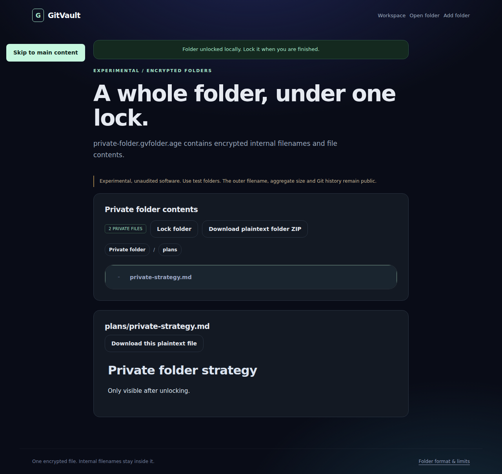
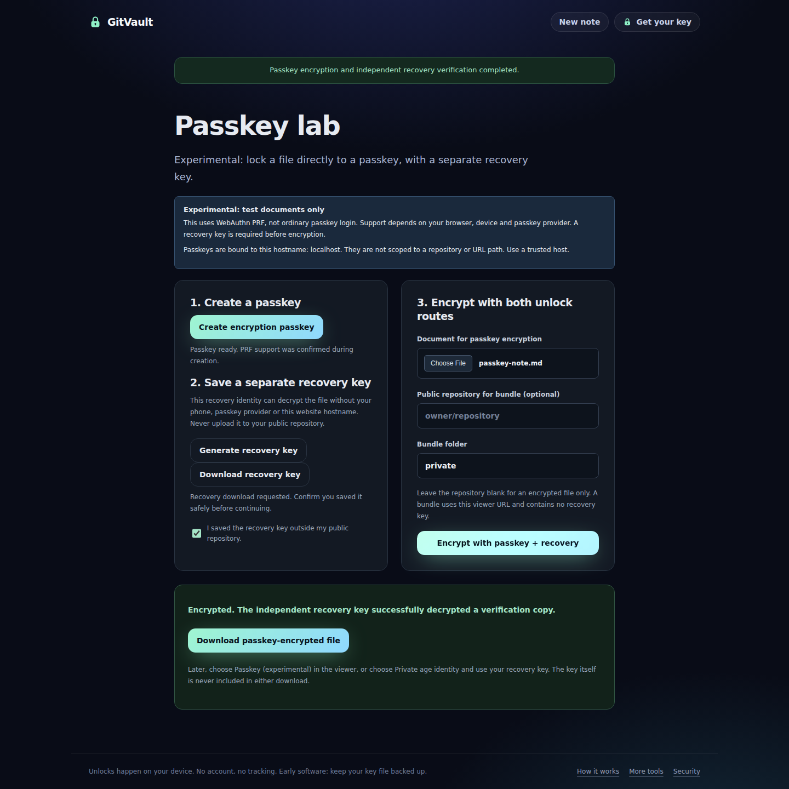
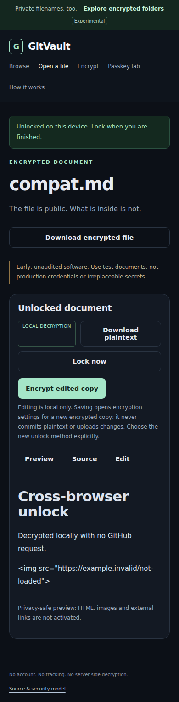

# GitVault: real browser screenshots

These are captures of the running application, not design mockups. All visible documents and credentials are intentionally public test fixtures.

Tested source commit: `86c63e6a20c83acd214fdb4cccc5ce6c90fe3356`.

[Successful verification and browser tests](https://github.com/junovhs/gitvault/actions/runs/38013605310)

The gallery updates after successful main-branch verification. Newer unverified commits may not be reflected here. Mobile-width images are browser viewport tests, not physical-phone certification. Passkey tests use a virtual authenticator, not a real phone or provider.

## Desktop home

## Mobile-width home

## Locked document

## Unlocked document

## Private folder after unlock

## Passkey lab with verified recovery

## Mobile-width unlocked document

